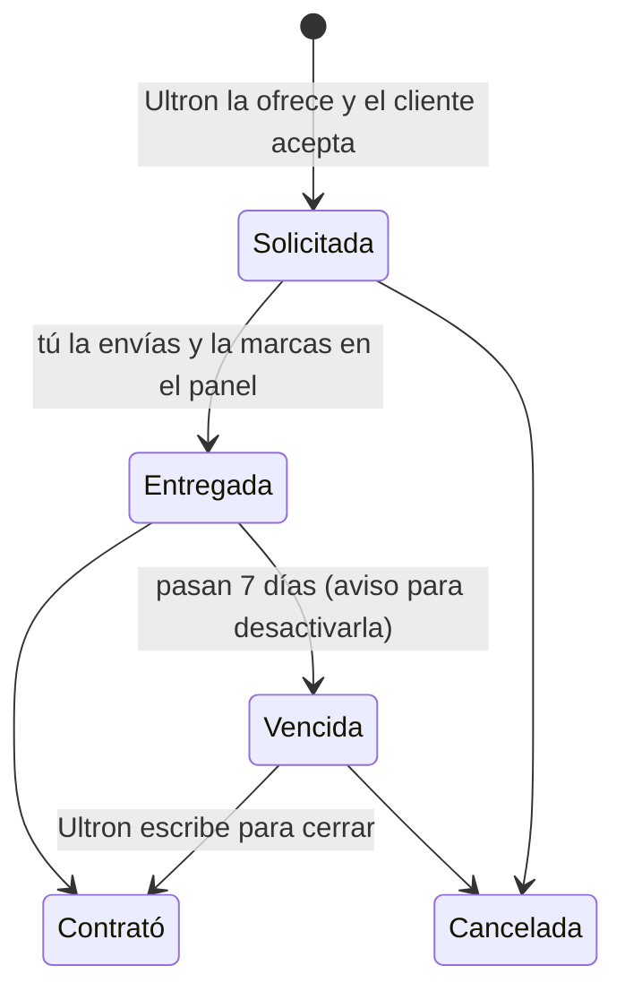

# ULTRON · Asesor comercial de WhatsApp para TAKER

**Ultron** es un bot de WhatsApp que trabaja como asesor comercial de **TAKER | Desarrollo de Software e Inteligencia Artificial**. Atiende a las personas que te escriben y no están en tus contactos, les presenta los servicios, resuelve objeciones, ofrece una demo gratuita de 7 días y convierte la conversación en un proyecto. Cuando un cliente quiere contratar, te pasa la conversación a ti.

Incluye un **panel web** para ver todos tus chats, controlar el bot, gestionar clientes y demos, editar el catálogo y configurar la IA.

> *"Transformamos ideas en soluciones digitales."*

---

## Contenido

- [Características](#características)
- [Cómo funciona](#cómo-funciona)
- [Requisitos](#requisitos)
- [Instalación en Windows](#instalación-en-windows)
- [Primer uso](#primer-uso)
- [Panel de control](#panel-de-control)
- [Ultron: la IA de ventas](#ultron-la-ia-de-ventas)
- [Estrategia comercial](#estrategia-comercial)
- [Configuración](#configuración)
- [Catálogo](#catálogo)
- [Instalar en un servidor 24/7 (Oracle Cloud gratis)](#instalar-en-un-servidor-247-oracle-cloud-gratis)
- [Estructura del proyecto](#estructura-del-proyecto)
- [Datos y privacidad](#datos-y-privacidad)
- [Solución de problemas](#solución-de-problemas)
- [Avisos importantes](#avisos-importantes)

---

## Características

| | |
|---|---|
| 🤖 **Asesor con IA** | Conversa como un vendedor: diagnostica, recomienda, maneja objeciones y cierra. Funciona con Hugging Face o con Claude, y si no hay IA disponible usa un menú clásico. |
| 🎯 **Solo a quien corresponde** | Por defecto responde solo a quienes **no** están en tus contactos. En cada chat puedes elegir *automática*, *responder siempre* o *no responder nunca*. **Nunca habla en grupos.** |
| 🎁 **Demo gratuita de 7 días** | Ultron la ofrece cuando el presupuesto frena la venta y te avisa con los datos del negocio. Tú la preparas y, cuando vence, Ultron escribe al cliente para cerrar. |
| 📋 **Ficha del cliente** | Guarda nombre, negocio, servicio, necesidad, presupuesto, fecha y correo mientras conversa. |
| 🔔 **Te avisa** | Cuando alguien quiere contratar, pide cotización, pide un descuento o una persona, recibes un aviso en *"Mensajes para mí mismo"* y el bot se pausa en ese chat. |
| ⏰ **Seguimientos con permiso** | Solo escribe de nuevo a quien lo autorizó (a las 24 h y a las 72 h), y solo de 8:00 a. m. a 8:00 p. m. |
| 📂 **Catálogo automático** | Genera el catálogo en imagen y PDF con tu logo y tus colores a partir de `catalogo.json`. |
| 🖥️ **Panel web** | Muestra tus chats de WhatsApp, clientes y demos, las respuestas del bot, un simulador de Ultron, el catálogo, la configuración y un registro en vivo. |
| 🧪 **Modo prueba** | Escríbete a ti mismo y el bot te responde como si fueras un cliente. |
| 🎤 **Notas de voz** (opcional, desactivadas) | Respuestas en audio con las voces de Windows. |

---

## Cómo funciona

```mermaid
flowchart LR
    C[Cliente escribe por WhatsApp] --> F{¿Chat privado?<br/>¿Corresponde responder?}
    F -- No: grupo, contacto<br/>o "no responder" --> X[Se ignora]
    F -- Sí --> M{Motor}
    M -- IA disponible --> U[Ultron<br/>Hugging Face o Claude]
    M -- Sin IA o error --> MN[Menú clásico]
    U -->|herramientas| H[Catálogo · Ficha · Demo<br/>Seguimiento · Asesor]
    H --> A[🔔 Aviso para ti<br/>y pausa en ese chat]
    U --> R[Respuesta al cliente]
    MN --> R
    P[Panel web<br/>localhost:3000] <--> B[(data/)]
    U <--> B
```

1. **whatsapp-web.js** abre WhatsApp Web en un Chrome sin ventana, vinculado a tu número.
2. Cada mensaje entrante pasa por los filtros: chat privado, no es tu contacto (o el chat está en *responder siempre*) y el bot está activo.
3. **Ultron** responde con IA. Usa herramientas para enviar el catálogo, guardar la ficha, pedir la demo, registrar el permiso de seguimiento o pasarte el cliente.
4. Si la IA falla o no está configurada, el bot responde con el **menú clásico** y no se pierde ningún mensaje.
5. Todo queda guardado en `data/` y se ve en vivo en el panel.

---

## Requisitos

- **Windows 10/11** (o Linux para un servidor; ver la [guía de Oracle Cloud](#instalar-en-un-servidor-247-oracle-cloud-gratis)).
- **Node.js 20 o superior** (probado con Node 24).
- **Google Chrome o Microsoft Edge** instalado. El bot usa tu navegador en vez de descargar Chromium.
- **Git**, para instalar una dependencia que viene de GitHub.
- Un número de WhatsApp en el celular, para vincularlo como dispositivo.
- Para la IA, **una** de estas opciones:
  - un token de **Hugging Face** con saldo para *Inference Providers*, o
  - una API key de **Anthropic** (Claude).
  - Sin ninguna, el bot funciona igual con el menú clásico.

---

## Instalación en Windows

```powershell
git clone https://github.com/TakizawaXD/ultron-whatsapp-bot.git G:\whatsapp-bot
cd G:\whatsapp-bot
$env:PUPPETEER_SKIP_DOWNLOAD='true'
npm install
```

> `PUPPETEER_SKIP_DOWNLOAD` evita descargar Chromium, unos 150 MB. El bot usa tu Chrome o Edge (ver `src/navegador.js`). Si tu navegador está en otra ruta, define `CHROME_PATH`.

Comprueba que todo esté bien:

```powershell
npm test          # prueba el flujo del menú, sin WhatsApp
npm run catalogo  # genera output/catalogo.png y output/catalogo.pdf
```

---

## Primer uso

1. Haz doble clic en **`Iniciar bot TAKER.bat`**, o ejecuta `npm start`.
2. Se abre el panel en **http://localhost:3000**.
3. En el celular: WhatsApp → ⋮ → **Dispositivos vinculados** → **Vincular dispositivo**, y escanea el QR que aparece en el panel. La sesión queda guardada en `.wwebjs_auth/`, así que no hay que volver a escanear.
4. Cuando el panel diga **Conectado**:
   - en **Configuración → Inteligencia artificial de Ultron**, pega tu token de Hugging Face o tu API key de Anthropic (se verifica antes de guardarse);
   - prueba a Ultron en **Respuestas del bot → Probar a Ultron** (no envía nada por WhatsApp);
   - o escríbete a ti mismo en WhatsApp (modo prueba; `reiniciar` empieza de cero).
5. Enciende el interruptor **Bot activo**.

El bot funciona mientras el PC esté encendido y la ventana del bot siga abierta. Para tenerlo siempre encendido, ver [servidor 24/7](#instalar-en-un-servidor-247-oracle-cloud-gratis).

---

## Panel de control

Abre **http://localhost:3000**. Solo responde desde el propio equipo (`127.0.0.1`), y las acciones exigen un encabezado especial, así que otras páginas web no pueden controlarlo.

| Pestaña | Qué hace |
|---|---|
| **Conversaciones** | *Todos mis chats*: tus chats reales de WhatsApp con mensajes y no leídos, y la opción de responder desde el panel. *Atendidos por el bot*: historial de cada conversación de Ultron. En cada chat privado eliges la **respuesta automática** (*automática / siempre / nunca*), pausas o reanudas el bot y ves la ficha del cliente. |
| **Clientes y demos** | Tabla con los clientes que atendió Ultron: datos, presupuesto, demo y seguimiento. Botones **Marcar entregada** (inicia los 7 días), **Contrató** y **Cancelar**. |
| **Respuestas del bot** | Simulador para **probar a Ultron** con IA real y vista previa de las respuestas del menú clásico. |
| **Catálogo** | Editar servicios y precios, guardar y ver el catálogo regenerado. |
| **Configuración** | Claves de IA, motor y modelo, reglas de venta, seguimientos, notas de voz, datos del negocio, números ignorados y cerrar sesión de WhatsApp. |
| **Registro** | Todo lo que hace el bot, en vivo. |

Arriba están el estado de conexión, el motor de IA activo, el interruptor **Bot activo** y las estadísticas del día.

---

## Ultron: la IA de ventas

### Motores

Se elige en *Configuración → Cómo responde el bot*:

| Motor | Modelo | Necesita | Notas |
|---|---|---|---|
| **Hugging Face** (predeterminado) | `deepseek-ai/DeepSeek-V4.1-Flash-1017`; también Qwen 3.8, Llama 3.3 70B, Gemma 4, GPT-OSS 120B o GLM 5.3 | Token de Hugging Face con permiso *Inference Providers* **y saldo** | Usa `router.huggingface.co` (API compatible con chat completions). Hugging Face cobra este servicio: compra créditos o suscríbete a PRO. |
| **Claude** | `claude-opus-5-5` | API key de Anthropic | Tiene activado el respaldo automático (`fallbacks: "default"`). |
| **Menú clásico** | — | Nada | Menú de 5 opciones con textos fijos. |

Las claves se guardan en `data/secretos.json`, que no se sube a git, y el panel nunca las vuelve a mostrar. Sin clave para el motor elegido, el bot usa el menú clásico automáticamente.

### Herramientas de Ultron

| Herramienta | Qué hace |
|---|---|
| `enviar_catalogo` | Envía el catálogo (imagen + PDF), una vez por conversación. |
| `registrar_datos_cliente` | Guarda la ficha: nombre, negocio, servicio, necesidad, presupuesto, fecha y correo. |
| `solicitar_demo` | Te avisa para preparar la demo gratuita, con los datos del negocio. |
| `autorizar_seguimiento` | Registra que el cliente aceptó que le escriban más adelante. |
| `pasar_a_asesor` | Te avisa y pausa el bot en ese chat (quiere contratar, cotización, descuento, pide una persona, pregunta fuera de sus límites). |
| `no_contactar` | Rechazo definitivo: nunca se le vuelve a escribir. |

Los mensajes que el cliente envía seguidos se agrupan durante 3 segundos para responder una sola vez.

---

## Estrategia comercial

Ultron sigue este proceso:

1. Identificar al cliente potencial.
2. Detectar qué servicio necesita.
3. Presentar la solución adecuada.
4. Comunicar el precio *desde*, el tiempo y la forma de pago.
5. Resolver objeciones.
6. Ofrecer la demo gratuita cuando corresponda.
7. Conseguir la contratación.
8. Recopilar los datos del proyecto.
9. Pasar al asesor humano.

**Técnicas de cierre:**
- **Directo:** "¿Arrancamos?"
- **Por beneficios:** lo que gana el cliente.
- **Por alternativa:** dos opciones concretas.
- **Por demostración:** "pruébala gratis 7 días".
- **Por agenda:** el siguiente paso concreto.

**Objeciones:** ante *"lo voy a pensar"* o *"no tengo presupuesto"*, indaga, resuelve y ofrece empezar por una versión sencilla, el pago en dos partes o la demo. Un "no" ambiguo no se da por perdido; un **rechazo definitivo se respeta**.

**Reglas de venta** (editables en *Configuración → Ventas*):
- **Forma de pago:** 50% de anticipo para iniciar y 50% al entregar.
- **Descuento:** Ultron puede *solicitar* hasta un **10%**, solo como último recurso. Tú lo confirmas: te llega un aviso.
- **Demo gratuita de 7 días** para cualquier servicio. Es una muestra sencilla (diseño y funciones básicas), sin integraciones con costo ni desarrollo ilimitado. El cliente sabe desde el principio que es temporal.

**Lo que Ultron nunca hace:**
- Inventar precios, descuentos, promociones, cupos, fechas límite, testimonios ni resultados garantizados. La única promoción que ofrece es la que escribas en *Promoción vigente*.
- Pedir pagos, datos bancarios, contraseñas ni documentos.
- Negar que es un asistente virtual si le preguntan directamente.
- Insultar, presionar de forma manipuladora o insistir tras un rechazo definitivo.

### Ciclo de la demo



---

## Configuración

Todo se edita desde el panel. Estas son las claves de `config.json`:

| Clave | Descripción |
|---|---|
| `asistente` | Nombre del asistente (`Ultron`). |
| `motor` | `huggingface`, `ia` (Claude) o `menu`. |
| `modeloHF` | Modelo de Hugging Face. |
| `ventas.pagos` | Forma de pago que comunica Ultron. |
| `ventas.descuentoMaximo` | % máximo que Ultron puede *solicitar* (0 = ninguno). |
| `ventas.demoDias` | Duración de la demo gratuita. |
| `promocion` | Promoción vigente real (vacío = ninguna). |
| `seguimientosHoras` | Horas para los seguimientos autorizados (`[24, 72]`). |
| `horarioSeguimientos` | Franja en la que puede escribir por iniciativa propia (`[8, 20]`). |
| `audios` | Notas de voz: `activo`, `modo` (`audio_y_texto` / `solo_audio`), `voz` (`Raul` / `Sabina`), `velocidad`, `enPruebas`. |
| `negocio`, `marca`, `eslogan`, `horario`, `moneda`, `contacto` | Datos que aparecen en el catálogo y en las respuestas. |
| `bienvenida`, `dueno` | Textos del menú clásico. |
| `pausaTrasRespuestaManualHoras` | Horas que el bot se calla cuando tú respondes en un chat (12). |
| `reinicioConversacionMinutos` | Minutos sin hablar para que el menú clásico empiece de nuevo. |
| `numerosIgnorados` | Números (con código de país, sin `+`) a los que nunca se responde. |
| `probarConmigo` | Modo prueba al escribirte a ti mismo. |
| `puertoPanel` | Puerto del panel (3000). |

---

## Catálogo

`catalogo.json` contiene los servicios. Cada uno tiene: `nombre`, `precioDesde`, `tiempo`, `incluye[]`, `descripcion` y `adicional` (si va en la lista corta de servicios adicionales).

| Servicio | Desde | Tiempo |
|---|---|---|
| Páginas web | $400.000 COP | 5 a 10 días |
| Tiendas online | $800.000 COP | 10 a 20 días |
| Aplicaciones móviles | $1.200.000 COP | 20 a 35 días |
| Sistemas a medida | $700.000 COP | 15 a 30 días |
| Bots y chatbots | $600.000 COP | 7 a 15 días |
| Mantenimiento y soporte | $100.000 COP | Según el requerimiento |
| *Adicionales:* Chatbot para WhatsApp · API y backend · Automatizaciones · Integración de IA | $800.000 · $500.000 · $600.000 · $700.000 COP | — |

El catálogo (imagen y PDF) se regenera solo cuando cambias `catalogo.json` o `config.json`. Usa el logo de `assets/logo.webp` y los colores de TAKER (`#00AEEF`, `#00E5FF` y `#05070B`).

---

## Instalar en un servidor 24/7 (Oracle Cloud gratis)

Para que Ultron funcione aunque apagues tu PC, instálalo en un servidor. **Oracle Cloud "Always Free"** da gratis y sin límite de tiempo una máquina Linux ARM de hasta 4 núcleos y 24 GB de RAM.

> **¿Y Vercel?** No sirve para este bot. Vercel ejecuta funciones que duran segundos y no guardan archivos, y el bot necesita un Chrome abierto las 24 horas con tu sesión de WhatsApp.

### 1. Crear la cuenta y el servidor

1. Regístrate en **oracle.com/cloud/free**. Pide tarjeta solo para verificar identidad; no cobra si usas recursos *Always Free*. Elige como **región principal** la más cercana (por ejemplo, *Colombia Central – Bogotá*). No se puede cambiar después.
2. **Compute → Instances → Create instance**:
   - **Image:** Canonical **Ubuntu 22.04**.
   - **Shape:** *Ampere* → **VM.Standard.A1.Flex**, 2–4 OCPU y 12–24 GB de RAM (dentro del límite gratuito).
   - **SSH keys:** *Generate a key pair* → **descarga la clave privada** (guárdala, por ejemplo, en `G:\claves\oracle.key`).
   - Crea la instancia y copia su **IP pública**.
   - Si sale *"Out of capacity"*, reintenta más tarde o con menos OCPU.

### 2. Conectarte

```powershell
ssh -i G:\claves\oracle.key ubuntu@IP_DEL_SERVIDOR
```

### 3. Preparar el servidor

```bash
sudo timedatectl set-timezone America/Bogota
sudo apt update && sudo apt upgrade -y
sudo apt install -y git fonts-noto-color-emoji fonts-liberation
curl -fsSL https://deb.nodesource.com/setup_22.x | sudo -E bash -
sudo apt install -y nodejs
sudo snap install chromium
sudo npm install -g pm2
```

### 4. Instalar el bot

```bash
git clone https://github.com/TakizawaXD/ultron-whatsapp-bot.git ~/whatsapp-bot
cd ~/whatsapp-bot
PUPPETEER_SKIP_DOWNLOAD=true npm install
npm test
```

El bot encuentra Chromium solo, en `/snap/bin/chromium`. Si lo tienes en otra ruta, define `CHROME_PATH`.

### 5. Arrancarlo para siempre

```bash
pm2 start src/index.js --name ultron
pm2 save
pm2 startup        # copia y ejecuta el comando que te muestra
pm2 logs ultron    # ver el registro (Ctrl+C para salir)
```

### 6. Abrir el panel desde tu PC (de forma segura)

El panel no queda expuesto a internet. Ábrelo con un túnel SSH:

```powershell
ssh -i G:\claves\oracle.key -L 3000:localhost:3000 ubuntu@IP_DEL_SERVIDOR
```

Con esa ventana abierta, entra a **http://localhost:3000** en tu navegador, escanea el QR y pega tu clave de IA.

> ⚠️ **Detén el bot de tu PC antes de vincular el del servidor.** Si los dos están activos con el mismo número, cada cliente recibiría respuestas dobles.

### 7. Actualizar

```bash
cd ~/whatsapp-bot && git pull && PUPPETEER_SKIP_DOWNLOAD=true npm install && pm2 restart ultron
```

> En Linux las notas de voz no funcionan, porque usan las voces de Windows (`src/tts.ps1`). Por eso vienen desactivadas.

---

## Estructura del proyecto

```
whatsapp-bot/
├── src/
│   ├── index.js             # Cliente de WhatsApp, filtros, Ultron, menú, avisos, seguimientos y demos
│   ├── ultron.js            # IA de ventas: prompt, herramientas, motores Hugging Face y Claude
│   ├── flujo.js             # Menú clásico (sin IA) y formato de precios
│   ├── panel.js             # Servidor del panel web y API (solo 127.0.0.1)
│   ├── estado.js            # Estado compartido: sesiones, estadísticas, registro
│   ├── generar-catalogo.js  # Catálogo HTML → PNG + PDF con Chrome
│   ├── navegador.js         # Busca Chrome, Edge o Chromium instalado
│   ├── voz.js · tts.ps1     # Notas de voz (voces de Windows + ffmpeg)
│   └── test-flujo.js        # Pruebas del menú clásico (npm test)
├── public/index.html        # Panel web (HTML + CSS + JS, sin dependencias)
├── assets/logo.webp         # Logo de TAKER
├── catalogo.json            # Servicios y precios
├── config.json              # Configuración del negocio y de Ultron
├── Iniciar bot TAKER.bat    # Lanzador para Windows
└── .puppeteerrc.cjs         # No descargar Chromium
```

Carpetas que se crean al usarlo y **no se suben a git**: `node_modules/`, `.wwebjs_auth/` (sesión de WhatsApp), `.wwebjs_cache/`, `.chrome-catalogo/`, `output/` (catálogo generado) y `data/` (conversaciones, estadísticas, claves y audios).

---

## Datos y privacidad

- Todo se guarda **localmente** en `data/`: conversaciones del bot, fichas, demos, estadísticas y claves. Nada de eso está en el repositorio.
- Los mensajes que responde Ultron se envían al proveedor de IA elegido (Hugging Face o Anthropic) para generar la respuesta.
- El panel solo escucha en `127.0.0.1`. En un servidor, accede a él con un túnel SSH; nunca abras el puerto 3000 a internet.
- **Nunca compartas tus claves** (token de Hugging Face, API key de Anthropic) en chats, capturas ni commits. Si se filtra una, revócala y crea otra.

---

## Solución de problemas

| Problema | Solución |
|---|---|
| El QR no aparece | Espera a que cargue WhatsApp Web (hasta 1 minuto). Si el registro muestra errores de `Socket`, actualiza whatsapp-web.js al último commit. |
| Se desconecta con `LOGOUT` | Elimina el dispositivo vinculado en el celular, borra `.wwebjs_auth/` y vuelve a escanear. |
| `The browser is already running` | Queda un Chrome del bot abierto. Ciérralo, o reinicia el PC o servidor. |
| Ultron responde con el menú | No hay clave para el motor elegido, o el proveedor falló. Mira el **Registro**: *"Purchase pre-paid credits"* significa que tu cuenta de Hugging Face no tiene saldo. |
| No contesta a alguien | ¿Es tu contacto? ¿Es un grupo? ¿El chat está en *No responder nunca*, pausado, o el bot está apagado? |
| `npm install` intenta descargar Chromium | Usa `$env:PUPPETEER_SKIP_DOWNLOAD='true'` (Windows) o `PUPPETEER_SKIP_DOWNLOAD=true` (Linux). |
| Disco C: lleno | El bot guarda todo en su carpeta. Usa `TEMP=G:\Temp` como hace `Iniciar bot TAKER.bat`. |

---

## Avisos importantes

- Usa [whatsapp-web.js](https://github.com/pedroslopez/whatsapp-web.js), que **no es oficial**. WhatsApp puede restringir números que automatizan mensajes. El riesgo es menor porque el bot responde a quien escribe y solo hace seguimientos autorizados, pero no lo uses para envíos masivos.
- whatsapp-web.js está fijado al commit `38eb45b` de su repositorio, que corrige un cambio de WhatsApp Web del 24/11/2026. Cuando salga una versión nueva en npm, conviene cambiar a ella.
- El uso de IA tiene costo según el proveedor: Hugging Face Inference Providers y Anthropic cobran por uso.

---

© 2026 TAKER · Andrés Montalvo. Todos los derechos reservados.
